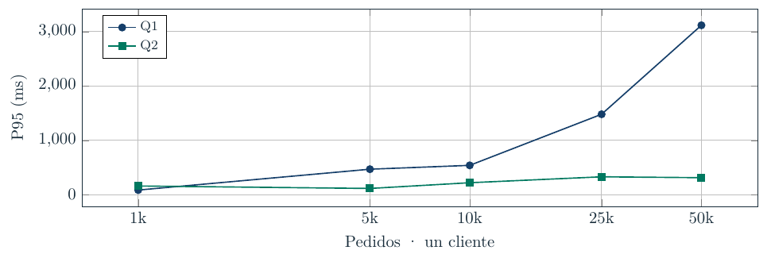

# EDGE-DB · Agregaciones JSON en una Raspberry Pi

[](hardware/inventario-pi.md)
[](protocol/diseno-y-decisiones.md)
[](protocol/mongodb-armv8-experimental.md)
[](reporte/articulo.pdf)

Proyecto personal de Luis Alberto Nafate Hernandez. Benchmark reproducible de consultas documentales en computación de borde. La plataforma observada es una Raspberry Pi Zero 2 W con una microSD ADATA de 64 GB. El estudio mide PostgreSQL 17.12 con JSONB y una compilación comunitaria de MongoDB 7.0.40. Incluye una revisión documental de MongoDB Community 8.0.

## Resultado observado

| Etapa | Evidencia |
| --- | --- |
| Factibilidad de PostgreSQL | Carga JSONB, comparación con oráculo Python y persistencia tras reinicio del clúster |
| Serie inicial de PostgreSQL | 6 corridas piloto y 70 finales utilizables. Se conservan 4 intentos de 50,000 pedidos previos a la enmienda |
| Comparación a 50,000 pedidos, un cliente | P95 mediano de Q1 de 3,133.3 ms en PostgreSQL y 4,148.1 ms en MongoDB. En Q2, 469.6 ms y 2,163.0 ms respectivamente |
| Escala en concurrencia | Hasta cinco clientes a 10,000 pedidos. En Q2 subió el throughput y también el P95 |
| Factibilidad de MongoDB | El binario oficial ARM64 requiere otra microarquitectura. La variante comunitaria 7.0.40 pasó la prueba funcional de 1,000 pedidos en la Pi |

La latencia incluye la ruta por Wi-Fi y SSH. El [resumen de la serie inicial](results/processed/benchmark/resumen_celdas.csv) conserva medianas, cuartiles y tamaño de muestra. El [artículo PDF](reporte/articulo.pdf) explica las diferencias entre las consultas y sus límites.

La [comprobación del voltaje interno](results/raw/alimentacion-software/resumen.json) es un ensayo posterior. El [plan de trabajo](protocol/plan-de-trabajo.md) indica qué sigue pendiente del requisito eléctrico.

La [prueba aislada de MongoDB](protocol/mongodb-armv8-experimental.md) conserva las salidas, los hashes y los intentos fallidos. La [matriz de la ampliación](results/processed/benchmark-extendido/matriz_consolidada.csv) contiene 70 corridas válidas por motor y 52 998 operaciones verificadas. En las 14 celdas comparables, PostgreSQL tuvo mayor throughput en las 14 y menor P95 en 13.

El [protocolo ampliado](protocol/protocolo-ampliado.md) describe las ventanas de 60 segundos, los controles y los diagnósticos de ambos motores.



## Dónde está cada evidencia

| Ruta | Contenido |
| --- | --- |
| [Protocolo y decisiones](protocol/diseno-y-decisiones.md) | Diseño, controles, mediciones y criterios de parada |
| [Bitácora](protocol/bitacora.md) y [auditoría de IA](protocol/auditoria-ia.md) | Cronología, herramientas, comprobaciones y revisión humana pendiente |
| [Registro del proceso](protocol/registro-del-proceso.md) | Código, datos, herramientas y asistencia de IA |
| [Prompt maestro](protocol/prompts/maestro-edge-db.md) | Alcance y reglas de trabajo |
| [Inventario](hardware/inventario-pi.md) | Plataforma instalada y datos físicos declarados |
| [Generador](dataset/generar.py) y [manifiesto](dataset/generado-v1/manifiesto.json) | JSONL reproducible y hashes SHA-256 |
| [Consultas](workloads/) | SQL medido para PostgreSQL y pipelines validados funcionalmente en MongoDB |
| [Runner](runner/experimento.py) y [telemetría](telemetry/) | Captura local, preparación y ejecución por SSH |
| [Evidencia](results/raw/) y [derivados](results/processed/) | CSV por intento, latencias por operación, métricas, planes y resúmenes |
| [Artículo](reporte/) | LaTeX y PDF, con gráficas compiladas a partir de los CSV |

## Reproducción

Los comandos se ejecutan en la laptop desde la raíz del proyecto. Se necesita Python 3.13, Paramiko y Tectonic. La Pi debe tener PostgreSQL 17.12 con su clúster `17/main`, una cuenta SSH con permisos de administración y una clave de host ya verificada. Usa un directorio nuevo para cada ensayo. El runner crea una base de estudio aislada y puede reiniciar el clúster si no encuentra otras conexiones de usuario. Ejecútalo durante una ventana de mantenimiento.

```powershell
python -m pip install -r telemetry/widget/requirements.txt
python dataset/generar.py dataset/reproduccion
python runner/experimento.py --host IP_DE_LA_PI --user USUARIO --dataset dataset/reproduccion --raw results/raw/reproduccion
```

El runner pide la contraseña al iniciar y conserva la evidencia en la laptop. El monitor gráfico es opcional y se usa fuera de la medición. Si una ejecución se interrumpe, conserva su carpeta y sus estados. `runner/continuar.py` implementa la enmienda específica del ensayo original a partir de sus tablas, oráculos y plan. Su invocación original fue `python runner/continuar.py --previous results/raw/benchmark-v1 --raw results/raw/benchmark-v2`.

Para regenerar las tablas y el PDF con los datos del estudio:

```powershell
.\reporte\reconstruir.ps1
```

Los [logs redactados](results/redacted/) reemplazan los identificadores de red del inventario crudo y de la prueba inicial de RTT. Los originales se conservan en la laptop.

## Referencias de partida

- [NIST SP 500-325, modelo conceptual de fog computing](https://doi.org/10.6028/NIST.SP.500-325)
- [PostgreSQL 17, tipos JSON](https://www.postgresql.org/docs/17/datatype-json.html) y [funciones JSON](https://www.postgresql.org/docs/17/functions-json.html)
- [Raspberry Pi Zero, modelos y especificaciones](https://www.raspberrypi.com/documentation/computers/zero.html)
- [Manual Arm Cortex-A53](https://documentation-service.arm.com/static/6040c321ee937942ba301626) y [requisitos ARM64 de MongoDB 8.0](https://www.mongodb.com/docs/v8.0/administration/production-notes/#arm64)

## Licencia y autoría

**Copyright © 2026 Luis Alberto Nafate Hernandez.** El código original del proyecto se distribuye bajo [Apache License 2.0](LICENSE). Esta licencia permite usar, modificar y redistribuir el código, también en proyectos comerciales, bajo sus condiciones de licencia y avisos de autoría.

El informe, sus figuras y la documentación original conservan todos los derechos reservados. El [aviso de autoría y alcance](NOTICE) identifica el material propio y el de terceros.
